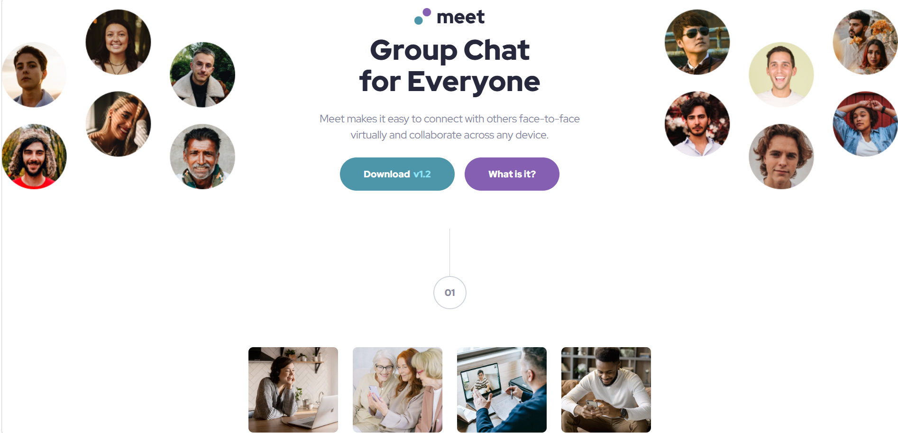
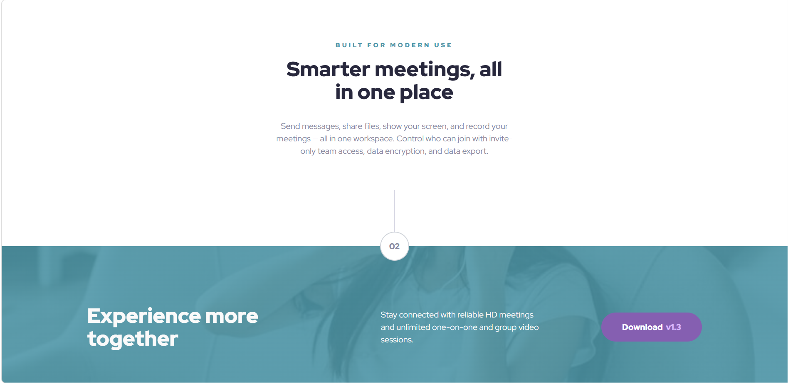

# Frontend Mentor - Meet landing page solution

This is a solution to the [Meet landing page challenge on Frontend Mentor](https://www.frontendmentor.io/challenges/meet-landing-page-rbTDS6OUR). Frontend Mentor challenges help you improve your coding skills by building realistic projects.

## Table of contents

- [Overview](#overview)
  - [The challenge](#the-challenge)
  - [Screenshot](#screenshot)
  - [Links](#links)
- [My process](#my-process)
  - [Built with](#built-with)
  - [What I learned](#what-i-learned)
  - [Continued development](#continued-development)
  - [AI Collaboration](#ai-collaboration)
- [Author](#author)
- [Acknowledgments](#acknowledgments)

## Overview

### The challenge

Users should be able to:

- View the optimal layout depending on their device's screen size
- See hover states for interactive elements

The design has three layouts (mobile, tablet and desktop), with a different set of images for each size.

### Screenshot

<p align="center">
  
</p>
<p align="center">
  
</p>

### Links

- Solution URL: [Meet-landing-page](https://github.com/hossamelgendy101/Meet-landing-page)
- Live site URL: [YOUR-LIVE-SITE](https://meet-landing-page-jq5o.vercel.app/)

## My process

### Built with

- Semantic HTML5 markup (`header`, `main`, `section`, `ul`, `li`, `h1`, `h2`)
- CSS custom properties
- CSS Grid
- Flexbox
- Mobile-first workflow with `min-width` media queries (768px and 1200px)
- Fluid typography with `clamp()`
- Multiple CSS background images
- Google Fonts (Red Hat Display)

### What I learned

- **Decorative images as CSS backgrounds:** The circles of faces around the title are decorative, so I used `background-image` on the header instead of `img` elements. On mobile and tablet one image is used and scaled with `background-size`, and on desktop two images are used (left and right) with multiple backgrounds and `background-position: left center, right center`.
- **Reserving space for a background:** The title has a `padding-top` that makes room for the circles above it, and the amount changes with the screen width.
- **A background image with a color overlay:** The "Experience more together" section uses a `linear-gradient()` with a semi-transparent color on top of the photo, so the text stays readable. I also learned that the `url()` in CSS is resolved from the CSS file's location and not from the HTML file.
- **Fluid typography and readable line lengths:** I used `clamp()` for the title and description sizes, and `max-width` in `ch` units so text lines don't become too long on medium screens.
- **A gallery that changes layout:** The four images use CSS Grid with two columns on mobile and four columns from 768px, and `minmax(0, 1fr)` to let the columns shrink without overflowing.
- **Changing direction with Flexbox:** The two header buttons are stacked on mobile and sit side by side from 768px, and the call to action section switches from a column to a row on desktop.
- **A shared component class:** The call to action button reuses the shared button class and adds its own modifier, so the button's shape is written only once.
- **Decorative step indicators:** The numbered circles with a vertical line between the sections are built with a line, a circle and negative margins to place them between two sections.

```css
.chat-header {
  background-image:
    url("../desktop/image-hero-left.png"),
    url("../desktop/image-hero-right.png");
  background-position:
    left center,
    right center;
  background-repeat: no-repeat, no-repeat;
}
```

### Continued development

- Add hover and focus states to the buttons (the challenge asks for hover states).
- Make the step indicators purely decorative for screen readers, for example with `aria-hidden` or pseudo-elements, since they contain only numbers.
- Reduce the amount of fixed values for spacing and use `clamp()` more consistently.
- Compare every value with the Figma file at each breakpoint.
- Learn Sass/SCSS after getting comfortable with plain CSS.

### AI Collaboration

During this project, I collaborated with an AI assistant (**Claude**) to enhance my workflow and problem-solving process.

- **Tools used:** Claude, as a technical consultant and reviewer.
- **How I used it:** For reviewing my HTML structure, choosing between `<picture>`, `srcset` and CSS backgrounds for the images, and finding the causes of layout bugs by checking values in the DevTools.
- **What worked well:** It explained concepts step by step and caught mistakes such as class names that don't follow a consistent naming system, a wrong background image path, and values that didn't match the design.
- **What I did myself:** I wrote the HTML and CSS by hand, read the values from Figma, and tested the layouts on different screen sizes.

## Author

- GitHub - [@hossamelgendy101](https://github.com/hossamelgendy101)
- Frontend Mentor - [@hossamnabil](https://www.frontendmentor.io/profile/hossamnabil)
- Twitter - [@hossamelgendy](https://www.twitter.com/hossamelgendy)

## Acknowledgments

- Thanks to **Frontend Mentor** for this challenge.
- Thanks to the developer community and AI assistant tools for guidance and feedback.
